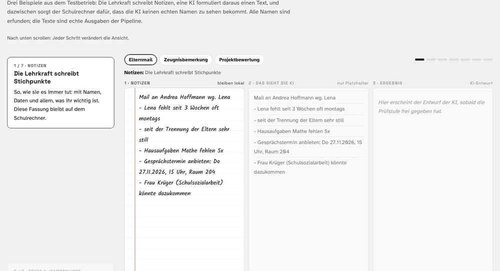

# blackDocu

Lokale Pseudonymisierung von Schülertexten, damit Lehrkräfte KI-Werkzeuge für Gutachten, Zeugnisbemerkungen, Förderpläne, Elternbriefe und Projektbewertungen nutzen können, ohne dass personenbezogene Daten die Schule verlassen.

Die Texte werden auf einem schuleigenen Rechner pseudonymisiert, erst dann von einem Sprachmodell bearbeitet und am Ende lokal wieder mit den echten Namen versehen. Die Zuordnungstabelle verlässt nie den Rechner.

> **Status: Phase 1 – Testbetrieb mit ausschließlich erfundenen Daten.**
> Echte Schülerdaten erst nach Freigabe durch Schulleitung und Datenschutzbeauftragte. Siehe [Vor echten Daten](#vor-echten-daten).

> **Haftungsausschluss:** Forschungsprototyp, kein zertifiziertes oder geprüftes Verfahren zur Anonymisierung oder Pseudonymisierung. Die Software wird ohne Gewähr bereitgestellt. Die Erkennung personenbezogener Angaben ist nicht vollständig; im Testbetrieb blieben einzelne indirekte Hinweise stehen. Pseudonymisierte Daten bleiben rechtlich personenbezogene Daten (Art. 4 Nr. 5 DSGVO). Der Einsatz mit echten Daten setzt eine eigene datenschutzrechtliche Prüfung durch die verantwortliche Stelle voraus und ersetzt nicht die Kontrolle jedes Textes durch die Lehrkraft.

- Projektbeschreibung: [`docs/PROJEKT.md`](docs/PROJEKT.md)
- Briefing für die Schulleitung: [`docs/Briefing_Schulleitung.pdf`](docs/Briefing_Schulleitung.pdf)
- Externes Code-Review und Bewertung: [`docs/REVIEW_BEWERTUNG.md`](docs/REVIEW_BEWERTUNG.md)

## Ablauf an einem Beispiel

[](https://batmanvane.github.io/blackDocu/)

**[→ Interaktive Webseite öffnen: Vom Stichpunkt zum Entwurf](https://batmanvane.github.io/blackDocu/)**
alle drei Beispiele (Elternmail, Zeugnisbemerkung, Projektbewertung) zum Durchscrollen

Ohne Internet: [`demo/pipeline_animation.html`](demo/pipeline_animation.html) herunterladen und im Browser öffnen.

### Datenfluss: Elternmail aus Stichpunkten

Echte Ausgabe der Pipeline, alle Namen erfunden.

**1. Stichpunkte der Lehrkraft** – bleiben auf dem Schulrechner

```text
Mail an Andrea Hoffmann wg. Lena
- Lena fehlt seit 3 Wochen oft montags
- seit der Trennung der Eltern sehr still
- Hausaufgaben Mathe fehlen 5x
- Gesprächstermin anbieten: Do 27.11.2026, 15 Uhr, Raum 204
- Frau Krüger (Schulsozialarbeit) könnte dazukommen
```

**2. Pseudonymisiert** – nur das sieht die KI

```text
Mail an <<MUTTER_01>> wg. <<SCHUELERIN_01>>
- <<SCHUELERIN_01>> fehlt seit 3 Wochen oft montags
- in einer aktuellen familiären Situation sehr still
- Hausaufgaben Mathe fehlen 5x
- Gesprächstermin anbieten: <<DATE_1>>, 15 Uhr, Raum 204
- <<LEHRERIN_01>> (Schulsozialarbeit) könnte dazukommen
```

| Original | Ersatz | Stufe |
|---|---|---|
| Andrea Hoffmann, Lena, Frau Krüger | `<<MUTTER_01>>`, `<<SCHUELERIN_01>>`, `<<LEHRERIN_01>>` | 1 Namensliste |
| Do 27.11.2026 | `<<DATE_1>>` | 2 Erkennung/Regeln |
| seit der Trennung der Eltern | in einer aktuellen familiären Situation | 3 lokales Sprachmodell |
| – | Prüfstufe findet nichts mehr → frei; wegen Familienbezug *nur lokal* | 4 Prüfstufe |

Fach, Uhrzeit und Raum bleiben lesbar (Positivliste).

**3. KI-Entwurf, lokal zurückgewandelt** – die Lehrkraft prüft und unterschreibt

> Sehr geehrte Frau **Andrea Hoffmann**, ich möchte Sie gerne bezüglich der aktuellen Situation von **Lena** kurz ansprechen. Leider fehlt sie in den letzten drei Wochen häufig am Montag, was uns natürlich Sorgen bereitet. Zudem wirkt sie in einer derzeit familiären Situation sehr still und zurückhaltend im Unterricht. Auch die Hausaufgaben in Mathe sind bisher fünfmal nicht eingereicht worden. Um das Ganze besser einordnen zu können, würde ich gerne einen Gesprächstermin mit Ihnen vereinbaren. Dieser findet am **Do 27.11.2026** um 15 Uhr in Raum 204 statt. Gerne könnte auch **Sabine Krüger** von der Schulsozialarbeit anwesend sein, um weitere Unterstützungsmöglichkeiten aufzuzeigen. Ich freue mich auf Ihre Rückmeldung und ein persönliches Gespräch.

Fett: lokal wieder eingesetzt. Die KI hat nur `<<MUTTER_01>>`, `<<SCHUELERIN_01>>`, `<<DATE_1>>` und `<<LEHRERIN_01>>` gesehen.

## So funktioniert es

```
Rohtext (lokal)
  │
  ├─ Stufe 1  Namensliste der Klasse    exakt + unscharf, Spitznamen, Genitiv, „Nachname, Vorname“
  │                                       → <<SCHUELERIN_01>>, <<LEHRER_03>>, <<MUTTER_02>> …
  ├─ Stufe 2  Erkennungsmodelle + Regeln Presidio, GLiNER, Flair (via noirdoc) + Regeln für
  │                                       Daten, E-Mail, Telefon; Positivliste für Schulwörter
  ├─ Stufe 3  lokales Sprachmodell       verallgemeinert indirekte Hinweise
  │           (Ollama)                    („seit der Trennung der Eltern“ → „in einer familiären Veränderung“)
  └─ Stufe 4  Prüfstufe                  Namensliste, Regeln und NER erneut → bei Fund gesperrt
  │
  ├─ out/pseudonymized   darf (nach Freigabe) an externe Modelle
  ├─ out/local_only      Gesundheit, Familie, Herkunft → nur lokales Modell
  └─ out/blocked         Prüfstufe hat etwas gefunden oder ein Schritt ist fehlgeschlagen
  │
Rückwandlung (lokal)     Platzhalter → echte Namen
```

Grundsätze:

- **Erkenner schlagen nur vor, ersetzt wird deterministisch** – und nur, wenn die Stelle wirklich im Text steht.
- **Sperren statt durchlassen.** Findet die Prüfstufe etwas oder schlägt ein Schritt fehl, wird der Text nicht weitergegeben.
- **Nur lokale Modelle.** LLM-Hosts sind im Code auf Loopback, private Netze und Tailscale beschränkt (`llm.assert_local`).
- **Platzhalter mit Geschlecht**, damit KI-Entwürfe grammatisch stimmen.

## Ergebnisse (Testbetrieb, 18.11.2026)

60 erfundene Testtexte, beim Tuning nie gesehen, mit anderen Hinweis-Mustern als die Tuning-Daten:

| Testset | Namen, Daten, Kontakte noch im Text | indirekte Hinweise noch im Text | unnötig ersetzt |
|---|---|---|---|
| Holdout (40 Texte) | 0 von 211 | 1 von 43 (2,3 %) | 3,1 % |
| Holdout2 (20 Texte, mit Personen außerhalb der Liste, E-Mail, Telefon, Adresse) | 0 von 132 | 0 von 24 | 4,5 % |

- 95-%-Konfidenzintervall: Namen/Daten unter 1,1 %, indirekte Hinweise 0,3–8 %.
- Alle 43 Texte mit sensiblen Angaben wurden als „nur lokal“ erkannt; nur 2 von 60 Texten wären extern bearbeitbar.
- Rechenzeit 5–15 s je Text auf einem Mac Studio (M2 Max, 32 GB).
- Grenze: Die Testtexte stammen von einem Sprachmodell. Vor einem Pilot muss mit von Lehrkräften erfundenen Texten nachgemessen werden.

## Einrichtung

Voraussetzungen: macOS oder Linux, [uv](https://docs.astral.sh/uv/), [Ollama](https://ollama.com) mit einem deutschfähigen Instruct-Modell (getestet: `qwen3.6:35b-a3b`), ca. 1 GB für die Erkennungsmodelle.

```bash
uv sync                                   # Python 3.13, noirdoc[full] (gepinnt auf 0.2.*)
cp .envrc.example .envrc && source .envrc # Ablageort der Modellgewichte (HF_HOME, FLAIR_CACHE_ROOT)
uv run noirdoc models pull                # spaCy + GLiNER; Flair lädt beim ersten Lauf nach
uv run blackdocu check                    # Ollama-Hosts erreichbar?
uv run pytest                             # Tests (ohne Modelle, schnell)
```

Konfiguration in [`config.yaml`](config.yaml): Ollama-Hosts und Modell, Prompt-Version, Erkenner, Prüfstufe, Pfade.

## Benutzung

```bash
# Testdaten erzeugen (Fakten aus festen Listen, LLM schreibt nur den Text drumherum)
uv run blackdocu generate -n 40                                  # Dev-Set doc_001–040
uv run blackdocu generate -n 40 --start 101 --pool holdout       # Endkontrolle, andere Muster
uv run blackdocu generate -n 20 --start 201 --pool holdout2      # + fremde Personen, Kontakte

# Pipeline laufen lassen und messen
uv run blackdocu run --stages 4 --prompt v5 --fewshot --only doc_101 doc_102 … --tag holdout
uv run blackdocu evaluate [out/runs/<lauf>]   # Bericht: out/runs/<lauf>/report.md
uv run blackdocu compare                      # alle Läufe nebeneinander

# Tuning von Stufe 3
uv run blackdocu bank out/runs/<dev-lauf>                         # Beispielbank aus Dev-Set
uv run blackdocu optimize out/runs/<dev-lauf> --rounds 3 --start v1 [--fewshot]

# Demo-Oberfläche (nur 127.0.0.1) und Screenshots
uv run blackdocu web [--run out/runs/<lauf>]                      # http://127.0.0.1:8765
uv run python demo/record.py --run out/runs/<lauf>                # Screenshots nach out/demo/shots
```

Jeder Lauf landet in `out/runs/<id>/` mit Konfiguration, Text nach jeder Stufe, Treffern, Sperrgründen, Laufzeiten und Metriken.

### Tuning

Drei Ansätze wurden gemessen (Details: [`prompts/stage3/README.md`](prompts/stage3/README.md)):

1. **Prompt von Hand nach gemessenen Fehlern nachschärfen** (v1 → v5): wirksam.
2. **Beispielbank** – ähnliche, geprüfte Fälle werden per Embedding gesucht und mitgegeben: wirksam.
3. **Automatische Prompt-Optimierung** durch das lokale Modell: machte das Modell vorsichtiger und ließ mehr durch – verworfen.

## Aufbau

```
src/blackdocu/
  stage1_namelist.py   Namensliste, Varianten, Familien-Platzhalter, Rückwandlung
  stage2_noirdoc.py    Erkenner-Verbund, Regeln (Datum/E-Mail/Telefon), Positivliste
  stage3_llm.py        lokales LLM, Anwenden der Vorschläge
  stage4_verify.py     Prüfstufe
  pipeline.py          Verkettung + Freigabe-Gate
  evaluate.py          Leckraten je Stufe und nach dem Gate, Konfidenzintervalle
  generate_synthetic.py  Testdaten mit Lösungsdateien
  fewshot.py           Beispielbank (SQLite + Embeddings)
  optimize.py          Prompt-Optimierung
  decisions_db.py      Entscheidungsprotokoll (nur Pseudonyme, prüft Freitext auf Klarnamen)
  llm.py               Ollama-Zugriff, nur lokale Hosts
  web.py               Demo-Oberfläche
data/      namelist.csv (fiktive Klasse), allowlist.txt, synthetische Texte + Lösungen
prompts/   versionierte Prompts für Stufe 3
demo/      Screenshot-Skript, Beispiele fürs Briefing
docs/      Projektbeschreibung, Briefing, Review
```

## Vor echten Daten

Offen und vor jedem Einsatz mit echten Schülertexten zu lösen:

- Lauf-Protokolle in `out/runs/` enthalten den Originaltext (für die Evaluation). Für echte Daten: Betriebsmodus ohne Protokolle oder verschlüsselt mit Löschfrist.
- Die Web-Oberfläche hat keine Anmeldung.
- Zuordnungstabellen (`noirdoc.namespace_root`) auf ein verschlüsseltes Volume außerhalb des Projektordners, mit Backup- und Löschkonzept.
- Datenschutz: Verzeichnis der Verarbeitungstätigkeiten, ggf. Datenschutz-Folgenabschätzung, Schulgesetz des Landes, Entscheidung lokal vs. extern.

## Lizenz

**Apache License 2.0** – siehe [`LICENSE`](LICENSE) und [`NOTICE`](NOTICE). Die Software wird ohne Gewähr bereitgestellt; es gilt der Haftungsausschluss oben.

Verwendete Bausteine und ihre Lizenzen (Stand 18.11.2026, aus den Paket-Metadaten bzw. Modellkarten):

| Baustein | Zweck | Lizenz |
|---|---|---|
| noirdoc | Pseudonymisierung, Zuordnung | MIT |
| Microsoft Presidio | Erkennung (Regeln + spaCy) | MIT |
| spaCy, Modell `de_core_news_lg` | Sprachmodell für Presidio | MIT |
| GLiNER, Modell `knowledgator/gliner-pii-edge-v1.0` | Erkennung | Apache-2.0 |
| Flair | Erkennung | MIT |
| Modell `flair/ner-german-large` | Erkennung (deutsche Namen) | **keine Angabe** – trainiert auf CoNLL-03, dessen Daten nur für Forschung freigegeben sind; vor produktivem Einsatz klären |
| Ollama (Python-Client) | Zugriff auf lokale Sprachmodelle | MIT |
| Qwen 3.6 (`qwen3.6:35b-a3b`) | lokales Sprachmodell | Apache-2.0 |
| FastAPI, Uvicorn | Demo-Oberfläche | MIT, BSD-3-Clause |
| RapidFuzz, PyYAML, Rich | Hilfsbibliotheken | MIT |
| Playwright | Screenshots für die Demo | Apache-2.0 |

Die Lizenzen verpflichten bei Weitergabe vor allem zur Nennung der Urheber und Lizenztexte; Apache-2.0 zusätzlich zum Hinweis auf Änderungen.
